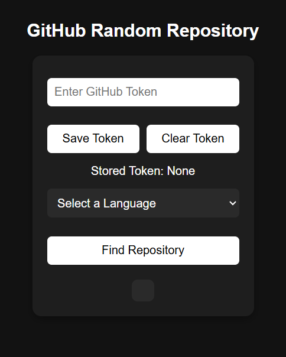
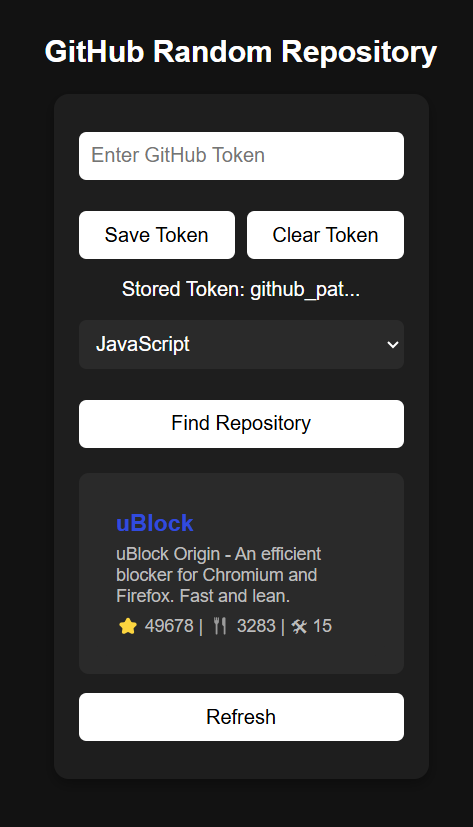
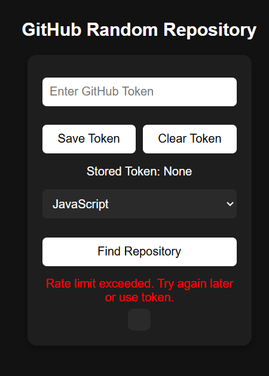

# GitHub Random Repository
A GitHub repository finder that allows users to select a programming language from a dropdown menu. | [Live Preview](https://lefyar.github.io/roadmap.sh-fe-projects/18-GitHub%20Random%20Repository/) \
Public searches work without a token. An optional token stays in memory for the current page.

